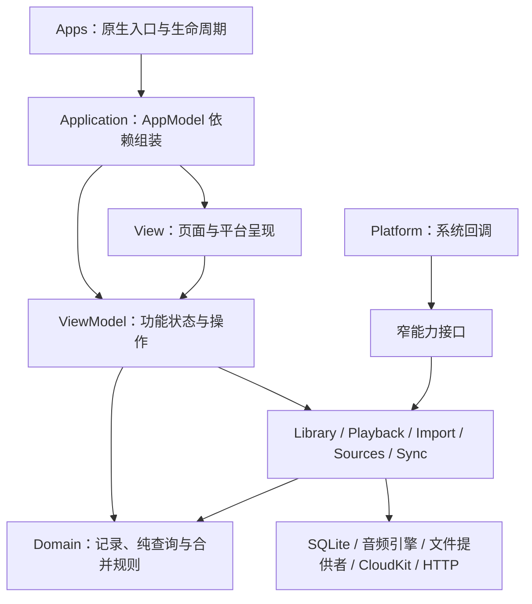

# iMusic 项目架构

本文描述当前源码的模块职责、状态所有权和关键数据流。目标平台为 iPhone／iPad
（iOS／iPadOS 17 起）与原生 macOS（14 起），共用 SwiftUI 功能代码及本地播放业务。
macOS 使用独立应用目标，不依赖将 iPad 应用直接运行在 Mac 上。

## 工程组成与依赖

| 位置 | 内容与构建边界 |
| --- | --- |
| `Apps/Shared/iMusicApp.swift` | iOS 与 macOS 应用入口、平台生命周期、菜单命令及窗口；创建进程共享的 AppModel |
| `Sources/iMusicKit/` | 本地 SwiftPM library target，包含原生 UI、领域模型和服务；目录是逻辑分层，当前并非多个独立 SPM target |
| `Web/WiFiUpload/` | React／TypeScript／Vite 上传网页，npm 与 package-lock.json 管理依赖 |
| `Plugins/WiFiUploadBuild/` | SwiftPM build-tool plugin；在构建时生成上传网页资源并打入应用 |
| `Tests/iMusicKitTests/` | SwiftPM 单元与集成测试，默认不创建硬件音频输出 |
| `Apps/Testing/`、`UITests/iMusicUITests/` | 独立安装的 iOS／macOS UI 测试宿主与共享 XCUIAutomation 回归代码 |
| `Scripts/`、`.github/workflows/` | 工程生成、格式化、架构／本地化检查、Release 构建安装及 CI |
| `Localization/Strings.json` | 原生与网页译文的维护源；生成 Apple 资源，网页构建时编译翻译表 |

原生依赖全部通过 **Swift Package Manager** 管理，不使用 CocoaPods。`Package.swift` 声明
GRDB、SFBAudioEngine、ZIPFoundation、SwiftNIO 与 NIOTransportServices；根目录和 Xcode
工作区的 `Package.resolved` 锁定解析版本。包使用 Swift tools 6.0，源码语言模式为 Swift 5。
应用签名、CloudKit 容器与可选平台能力由应用构建配置提供，不写入共享领域模型。

## 依赖与边界

两个原生应用目标共享本地 SPM 产品 `iMusicKit`。包内按 Application、Domain、Library、Playback、Import、Sources、Sync、Platform、View、ViewModel 分层。AppModel 只在启动时组装依赖、连接平台回调并执行一次性恢复；页面不再绑定 AppModel。View 绑定相应的 ViewModel，不直接操作 SQL 或音频节点。

- Domain：记录与路由、Track／Playlist／QueueEntry、PlaybackSession／PlaybackTimeline、SyncEnvelope 字段合并、LibraryCatalog 查询、ListeningSummary 聚合及标签修复预览。
- Library：GRDB/SQLite WAL、统一初始 Schema、FTS5 与 CJK 子串查询、托管文件、备份、标签覆盖、在线封面。
- Playback：唯一进程级播放会话、SFBAudioEngine 适配、预加载、音效、睡眠、音频时钟和进度预览。
- Import：ImportCoordinator 入口、托管副本导入、分块复制、SHA-256、恢复日志、共用元数据读取及局域网上传；原文件关联扫描委托 Sources。
- Sources：原文件索引、系统物化与协调、安全作用域、后台解码器准备、逐曲定位和当前源观察。
- Sync：元数据与大文件分区；CKSyncEngine、版本合并、持久化 outbox、按需资产下载。
- Platform：锁屏／控制中心、音频中断／路由变化、CoreAudio 输出名称、CarPlay 系统模板。
- Application：进程级依赖组装与启动，不保存搜索、选择、编辑草稿或弹窗开关。
- View：按功能归类的 SwiftUI 页面、组件和平台呈现适配。
- ViewModel：同样按功能归类的可观察页面状态、查询结果、编辑草稿与交互操作。

## 界面与状态所有权

```text
Sources/iMusicKit/
├── Application/                     # AppModel 组装与启动
├── Domain/                          # 记录、查询、统计、合并规则
├── Library/                         # 存储、快照、命令、删除、归档与元数据服务
├── Playback/                        # 唯一播放状态机、引擎、音频偏好、收听记录、来源生命周期
├── Import/                          # 托管导入、恢复、元数据读取
│   └── WiFi/                        # 地址、配对、路由、流式写盘、NIO 适配
├── Sources/                         # 原文件授权、物化、索引、定位与观察
├── Sync/                            # CloudKit 元数据、资产、旧格式读取与编码
├── Platform/                        # 系统媒体、CarPlay、后台云通知
├── View/
│   ├── Navigation/                  # Root、Destination、呈现与底栏
│   ├── Home/                        # Home 组装及五个独立 section
│   ├── Library/
│   │   ├── SongList/                # 泛型列表、表格标题、播放操作栏
│   │   ├── Collections/             # 歌手／专辑／流派／歌单页面及卡片
│   │   └── …                        # All Songs、歌单详情、Trash、重复歌曲
│   ├── Player/                      # 全／迷你播放器、封面、控制、队列、音效、音量
│   ├── Editors/                     # 歌曲、批量、歌单、选歌编辑器
│   ├── Import/                      # Wi-Fi、导入报告、备份导出
│   ├── Settings/Sections/           # 统计、外观、来源、归档、云、在线标签、关于
│   ├── Statistics/                  # 收听图表
│   └── Shared/                      # 封面缓存、歌曲行、菜单、搜索与布局
└── ViewModel/
    ├── Navigation/                  # scene 导航与跨功能呈现
    ├── Home/                        # Home 分区数据与派生结果
    ├── Library/
    │   ├── SongList/                # SongListState 与 PlayableSongList 能力
    │   ├── Collections/             # 四类集合的独立查询状态
    │   └── …                        # 歌曲集合、歌单详情、Trash、重复分组
    ├── Player/                      # Player、NowPlaying、SongActions
    ├── Editors/                     # 独立可编辑草稿
    ├── Import/                      # Picker、Audio、Folder、Archive、Wi-Fi、Diagnostics
    ├── Settings/                    # 偏好、云、在线许可、来源管理与修复
    ├── Statistics/                  # 统计展示结果
    └── Shared/                      # 共享资料库快照与操作状态
```



图示表达主要调用方向，不代表编译器已隔离各目录。服务之间通过明确协作者共享事务、
原文件授权和播放状态；`Platform` 通过 `CarPlayLibraryProviding`、`CloudNotificationHandling`
等能力接口连接应用。CarPlay 与后台云通知分别接入，不经由彼此转发整个 AppModel。

| 边界 | 所有者及职责 | 生命周期 |
| --- | --- | --- |
| 依赖组装 | AppModel：创建存储、导入器、音频、云和 feature models；连接系统媒体及云回调 | 应用进程 |
| 资料库 | LibraryViewModel：共享快照与刷新代次保护；LibraryCommands：歌曲／歌单修改；LibraryDeletionWorkflow：确认后的永久删除 | 应用进程 |
| 播放 | PlaybackCoordinator：唯一音频会话；PlayerViewModel：播放页面使用的明确依赖 | 应用进程，共享队列 |
| 偏好 | PreferencesViewModel：持久化外观、Home 布局、歌手拆分和联网许可 | 应用进程 |
| 导入与归档 | ImportViewModel：组成与生命周期；Picker／AudioImport／FolderImport／Archive／WiFiTransfer／Diagnostics 子模型分别持有状态和任务 | 跨页面任务 |
| 跨功能呈现 | PresentationViewModel：请求打开播放器、队列或某首歌曲的编辑器；不存编辑草稿 | 跨页面请求 |
| 页面状态 | SongCollection／PlaylistDetail／TrashSongs／四类 Collection／Settings 等 ViewModel：本页查询、选择、确认、范围与结果 | 页面实例 |
| 编辑器 | TrackEditor／BatchTrackEditor／PlaylistEditor／PlaylistSongPicker ViewModel：草稿、预览、选择及异步结果 | 每次打开独立实例 |
| 全播放器工具 | NowPlayingViewModel：均衡器弹窗；复用 PlayerViewModel 的播放会话 | 每个全播放器实例 |
| 导出文件 | BackupExportViewModel：复制进度、原子替换和结果信息 | 每个导出 sheet |
| 导航 | RootViewModel：每个窗口自己的 sidebar selection；DestinationViewModel：本路由新建歌单呈现开关 | 每个 scene／路由 |

RootView 按尺寸类别选择紧凑宽度的 TabView 或常规宽度／Mac 的 NavigationSplitView 并转发生命周期。AppPresentations 统一挂载跨页面 sheet／文件选择器；LibraryFooter 呈现导入进度、播放错误和 MiniPlayer。页面主体、编辑器、播放器组件分别位于单独文件。根视图的公开初始化入口接收 AppModel 仅用于创建 scene-local RootViewModel；子页面不引用、继承或持有 AppModel。

有独立页面状态的 View 使用 `@State` 保持自己的 `@Observable` ViewModel 身份，使用 `@Bindable` 提供原生控件绑定。复用共享偏好或播放状态的组件只接收对应 feature model 或 PlaybackCoordinator。物理滑块拖动标记、环境尺寸和 dismiss 等呈现细节保留在 View；播放时钟仍由 PlaybackCoordinator／PlaybackTimeline 管理，不建立第二份时间副本。

搜索框与查询属于具体页面及其 ViewModel。歌曲列表只筛选当前路由中的歌曲；歌单列表只搜索歌单名。不同页面／picker 的查询和选择独立。iPhone 切换 Tab 时保留各页面状态，Mac 切换 sidebar 路由时用路由 identity 创建对应页面状态。编辑器只修改本次草稿，保存时调用资料库操作；取消不会提交标签。编辑流程由编辑器 ViewModel 协调；封面验证和入库委托 ArtworkImporting，联网查询委托 OnlineMetadataProviding，编码修复委托 TagEncodingRepair。封面可先存为草稿资源，歌曲／歌单记录仅在 Save 时提交。

新增功能遵守单向依赖：`View → ViewModel → existing domain/services`。不要把页面状态放回 AppModel、给所有页面传整个 application container，或将 SwiftUI View／Binding／NSSavePanel 导入 ViewModel。跨功能共享记录和播放会话应复用现有 feature boundary；新查询、编辑草稿和展示结果应留在本页面模型。SwiftPM 自动发现这些目录下的源码，不需要给 Xcode 工程逐文件登记；Apps／UITests 中的宿主与测试源码仍需通过工程配置脚本维护引用。

### 资料库读写与异步结果

资料库的查询、操作与 UI 发布分开维护：

1. `LibrarySnapshotLoader` 在主 actor 外读取记录及本机文件可用性，返回命名的
   `LibrarySnapshot`；`LibraryViewModel.refresh()` 用刷新代次丢弃迟到结果，再在主 actor 发布。
   此对象是一次刷新结果，不承诺它的多次数据库读取来自同一个 SQL 读事务。
2. `LibraryCatalog` 从当前快照和歌手拆分偏好生成纯查询结果。分类页面和列表 ViewModel
   拥有本页搜索、排序、选择与确认状态；View 渲染不做磁盘存在性探测。
3. 普通修改经 `LibraryCommands` 进入 `LibraryStore`；永久删除经
   `LibraryDeletionWorkflow` 协调事务、播放引用修复、托管文件清理、刷新及可选同步。
4. 修改成功后，通过弱引用的 `onChange` 请求刷新。命令服务不持有 View，避免与共享
   LibraryViewModel 构成保留环；数据库事务仍由 LibraryStore 的同一个 writer 管理。

`availableTrackIDs` 是缓存的可用性提示。对关联曲目，它表示已完成入库且授权代次匹配，
不保证文件提供者始终保留本地内容；播放仍必须重新解析、物化与验证来源。

### 布局、搜索与平台差异

- 紧凑宽度（通常为 iPhone）根导航为四个 Tab；Home／Settings 不附加常驻搜索。All Songs 与 Playlists
  以及导航进入的可搜索子页，分别绑定自己的查询和准确的搜索提示。
- 常规宽度的 iPad 与 macOS 使用 NavigationSplitView；iPad 紧凑分屏可切换为 TabView。macOS 歌曲主体为原生 Table，触屏为 List；
  右键菜单、滑动操作、窗口与系统文件选择器留在 View／平台适配层。
- `SongListSummary` 共用计数、时长和操作，由独立呈现组件管理系统版本对应的样式与间距。
  `SongListView` 选择固定位置：macOS 为 Table 上方的独立布局，旧版 iOS 为 List 的
  顶部安全区 inset；iOS／iPadOS 26 为歌曲视口底部的玻璃浮层。
  macOS 歌曲表格使用系统 `.title3`（15 pt），歌曲及回收站歌单统计栏使用 `.body`（13 pt），
  避免将常读内容缩为 caption；字体调整不覆盖工具栏或触屏样式。
  iPhone／iPad `TouchSongList` 的行只包含实际歌曲，空态与搜索无结果为剩余内容区的居中
  overlay，不创建虚假列表行，也不移除作为主滚动宿主的 List。`CollectionGrid` 为空时填充页面，Home 等滚动页面使用
  `PageScrollView` 为短内容提供视口高度，`EqualTileRow` 统一卡片尺寸。
- 其他页面的占位必须相对实际内容区布局，保留安全区、工具栏、页签与底部播放栏所占空间；
  不能将统计栏与空态作为一个整体垂直居中，也不能给动态字体文案固定高度。
- 强调色遵循系统；PreferencesViewModel 保留浅深显示模式、Home 布局等偏好，
  不提供独立 Accent Color 设置，不覆盖原生选中背景。

### 歌曲列表基础能力与功能扩展

SwiftUI 的 View 是值类型，列表使用泛型组合与能力协议，不使用 UIViewController 式的
视图基类继承。`View/Library/SongList/SongListPage` 是歌曲页面的通用布局容器，由
SongCollectionView 与 PlaylistDetailView 分别组合。容器只接收标题文字、页面搜索绑定、
搜索提示和 header／content builder，不持有 feature ViewModel、资料库或播放器，不解释
路由，也不管理菜单、弹窗或编辑操作。生命周期跟随所属页面，不新增可变页面状态。
各功能 ViewModel 提供当前标题和独立查询，feature View 提供 SongListView 及自己的操作。
同目录的 `SongListView` 只负责统计、居中空态、
macOS Table、iPhone／iPad List、选择与排序绑定。它通过 ViewBuilder 接收行、统计栏操作、
空态与上下文菜单，并通过可选闭包接收重排与激活操作；不接收 LibraryDestination，
也不判断是否为回收站或歌单。

`SongListSummary` 只接收数量、总时长及操作 builder，不生成虚假歌曲。
`TouchSongList` 只管理触屏歌曲 List，重排只绑定歌曲 ForEach。汇总栏和其播放按钮由
`SongListView` 放在固定安全区中，不属于列表行，保持常驻和独立操作；
旧版触屏放在顶部，新版触屏由 `GlassSongListContent` 注册为底部系统 bar。
空态也由它在剩余内容区呈现。
不嵌套纵向滚动容器，也不通过监听 offset 手动模拟导航栏动画。

- `AllSongsView`：拥有分类快捷入口，通过 `SongCollectionView` 的 header builder 注入固定
  控件，位于搜索框和统计栏之间；其他歌曲集合使用空 header。快捷栏在所有平台保持单行，
  空间不足时横向滚动，独立于下方歌曲的纵向滚动。
- `SongCollectionView`／`SongCollectionViewModel`：所有歌曲、收藏及歌手／专辑／流派筛选。
- `PlaylistDetailView`／`PlaylistDetailViewModel`：歌单条目移除、重排、排序、重命名和编辑器。
- `TrashSongsView`／`TrashSongsViewModel`：恢复、永久删除和确认弹窗，不依赖播放器。
- `ViewModel/Library/SongList/SongListState`：每页各自持有搜索、排序和选择；共享过滤、
  排序和选择解析。`PlayableSongList` 协议只为活跃歌曲列表提供保留条目身份的播放能力。

新增列表场景应组合基础列表并提供本场景的行与操作；不要向基础组件添加场景标志、路由
分支或业务弹窗。歌单使用 QueueEntry.id 标识每个出现位置；移除和播放不得退化为 Track.id。
过滤、排序或存在隐藏失效条目时禁用按索引重排，避免修改不对应的条目。

`View/Shared/LibrarySearchField` 复用原 Trash 的原生输入适配：iPhone／iPad 使用
`UISearchTextField`，macOS 使用 `NSSearchField`；仅用户编辑和清除事件写入绑定，不在
销毁时清空查询。`LibrarySearchInput` 只分派外观；`GlassLibrarySearchInput` 与
`LegacyLibrarySearchInput` 分文件管理尺寸和间距。新版为原生输入框边界外的阴影保留
绘制空间，不重复添加玻璃或实色背景。`contentSearch` 在 iOS 26 通过顶部
`safeAreaBar` 让输入框悬浮在列表上，旧版保留顶部 inset；macOS 保留系统 `.searchable`。
All Songs、收藏、元数据歌曲页、歌单详情和选歌弹窗复用上述搜索组件；歌曲集合与歌单
详情通过 SongListPage 统一组合固定搜索布局，选歌弹窗使用 `contentSearch`。
选歌弹窗显式使用自己的 inline 导航标题，避免继承呈现页的标题模式并在搜索时改变栏高。
Trash 两类子页复用同一输入组件，
保留其分类绑定与 macOS 工具栏适配。组件生命周期跟随页面，查询仍由
各页面 ViewModel 持有，没有共享查询或新的服务依赖。卡片集合页继续使用导航栏搜索。
活跃歌曲列表及选歌弹窗不安装 UISearchController。`SongListPage` 在 iPhone／iPad
用独立 VStack 固定大标题。旧版 iOS 的搜索与 feature header 在 SongListView 上方独立
占位；iOS 26 的搜索与可选 header 由 `GlassSongListPageContent` 组合到同一个顶部
`safeAreaBar`，初始歌曲避让控件，滚动后可以从搜索和快捷胶囊下方经过。
header builder 返回可选内容；没有额外控件时仍有搜索，不注册空系统 bar。
大标题使用系统 `.largeTitle.bold()`、动态字体和无障碍 heading，标题文字由
SongCollectionViewModel 从现有 catalog 派生，PlaylistDetailViewModel 从当前歌单快照
派生，重命名后随快照更新。系统导航栏保留返回、导入与 feature 提供的菜单、编辑
按钮，关闭其随 List 联动的大标题并用空 principal 项避免重复标题；实际显示的大标题
属于固定内容布局，不随歌曲滚动折叠、拉伸或回弹。所有歌曲、收藏、歌手／专辑／流派
歌曲页、歌单详情及其空态、短列表共享这一约束；快捷栏只在空间不足时独立横向滚动。
统计栏由 SongListView 固定展示，新版在底部、旧版在顶部。其他使用 contentSearch 的页面
共享对应系统的搜索浮栏或 inset。搜索容器不叠加实色背景，保留列表表面及搜索框自身阴影，
避免分组列表上出现矩形色带。旧版统计栏背景显式设置 `ignoresSafeAreaEdges: []`；
空态保留原生纵向 List，只有歌曲行纵向滚动。不遍历或修改 UIKit 私有标题视图。
macOS 保留系统工具栏标题与搜索。

iOS／iPadOS 26 的固定控件使用原生 Liquid Glass：搜索继续由 `UISearchTextField` 自动
适配，不额外叠加玻璃、实色背景或手工阴影；`GlassAllSongsShortcuts` 使用系统 `.glass`
按钮和 `GlassEffectContainer`，在横向滚动文档内部预留阴影空间，并关闭滚动视图的绘制
裁剪以完整呈现玻璃的外部装饰；`GlassSongListSummary`
将统计与独立播放操作放在单一 `.regular` 玻璃胶囊中，不给整栏添加点击行为，也不嵌套
玻璃表面。两类控件的旧版布局分别留在 `LegacyAllSongsShortcuts`、
`LegacySongListSummary`，公共入口只做系统可用性分派。样式组件生命周期跟随页面，仅
接收内容 builder，不持有模型、查询或播放状态。系统材质负责外观与辅助功能适配；
歌曲内容行不使用玻璃。`GlassSongListPageContent` 只接收 header／content builder，
生命周期跟随 SongListPage，不持有模型、滚动 offset 或额外状态；它将固定 feature
控件注册为系统 bar，并采用柔和的滚动边缘效果保证下穿内容时的可读性，不添加整块
实色背景。大标题在滚动视口之外，搜索、header 与统计保持固定，只有歌曲行纵向滚动。

`GlassSongListContent` 负责 iOS／iPadOS 26 的统计栏摆放，通过底部 `safeAreaBar` 与柔和
滚动边缘效果让歌曲从玻璃统计栏下方滚过，同时为列表末尾和居中空态预留内容空间。
该布局只接收 content／summary builder，生命周期跟随 SongListView，不持有播放器状态、
MiniPlayer 引用或滚动 offset。RootView／LibraryFooter 继续负责播放器占用的空间；
内层统计栏使用继承的安全区，自然停在 MiniPlayer（如有）与底部系统导航栏上方。
iOS 26 的紧凑 Tab 使用 `GlassTabFooter` 注册原生 `tabViewBottomAccessory`，由系统
管理玻璃表面及滚动内容避让，所有 Tab 与其详情页共用同一个播放器附件。导入进度
及播放错误由 `LibraryOperationStatus` 在 Tab 根页面独立呈现并预留高度；不把可变高度
的操作状态塞入系统播放器附件。LibraryFooter 组合相同状态与播放器供其他布局复用。26.1 起通过
`isEnabled` 控制附件显示，26.0 则通过空内容隐藏；两者不替换 TabView 或导航栈身份。
分栏布局实际预留 LibraryFooter 的高度，播放器使用四周留白的玻璃浮层，保证内层
Summary 停在它上方。避免在分栏外部再注册同边的 safeAreaBar，使两个浮层相互覆盖。
旧版紧凑布局保留底部 inset，分栏与 macOS 保留 VStack。

### 集合、Home、设置与编辑器

| 功能 | 组件与状态边界 |
| --- | --- |
| 集合浏览 | CollectionGrid 只管理布局、搜索呈现和空态；ArtistCollection／AlbumCollection／GenreCollection／PlaylistCollection 的 View 与同名 ViewModel 分别维护查询、卡片、导航与菜单，CollectionCard 共享封面／标题展示 |
| Home | HomeView 仅按偏好分派 section；HomeContinueSection、HomeCategoriesSection、HomePlaylistsSection、HomeRecentSection、HomeStatisticsSection 各自展示内容，HomeViewModel 提供最近曲目、队列及统计派生数据 |
| 设置 | SettingsView 只组合 Statistics／Appearance／MusicSources／Backup／Cloud／OnlineMetadata／About 七个 SettingsSection；CloudSettingsViewModel 处理云操作，OnlineMetadataSettingsViewModel 管显式联网许可及撤销 |
| 统计与重复歌曲 | ListeningSummary 生成纯统计和排名；ListeningStatsViewModel 提供展示结果，DuplicatesViewModel 生成稳定的 DuplicateGroup，排除无托管哈希的关联原文件 |
| 歌曲菜单 | TrackActions 负责菜单呈现；SongActionsViewModel 统一排队、收藏、下载及编辑请求 |
| 编辑器 | TrackEditor／BatchTrackEditor／PlaylistEditor 各有独立草稿；ArtworkImporting 统一封面验证和存储，OnlineMetadataProviding 隔离联网客户端，TagEncodingRepair 只生成预览；取消不提交记录 |

## 播放

播放职责由以下协作者共同完成，只有 PlaybackCoordinator 决定队列和 transport 状态：

| 类型 | 当前职责 |
| --- | --- |
| `PlaybackCoordinator` | 队列、当前条目、播放意图、自动／手动切换、失败恢复与引擎命令 |
| `PlaybackEngine`／`SFBPlaybackEngine` | 引擎协议与 SFBAudioEngine 适配，隔离实际解码／渲染 |
| `PlaybackAudioSettings` | 音量、静音前音量、速率、均衡器及本机偏好持久化 |
| `PlaybackHistoryRecorder` | 实际收听累计、稳定事件 ID、显式保存与周期 checkpoint |
| `PlaybackSourceController` | 当前／预加载原文件的异步准备、取消令牌、授权资源与文件观察生命周期 |
| `PlaybackTimeline` | 高频实际进度和拖动预览，独立于队列／循环等低频会话状态 |

PlaybackCoordinator 持有唯一队列。队列条目与歌曲分别有 UUID，允许同一歌曲在歌单中出现多次。自动单曲循环不改变手动下一首行为；随机顺序和实际历史可持久化。

PlaybackCoordinator 依赖 PlaybackEngine 协议，App 默认注入 SFBPlaybackEngine。自动化逻辑测试显式注入不创建声卡或 AVAudioEngine 的测试实现；真实音频引擎的集成测试仅在 `IMUSIC_AUDIO_TESTS=1` 时运行，全部生成素材为静音 PCM。普通测试和编译不播放测试音。

SFBAudioEngine 固定到 `8455c970de34a63422857c4b4d6fffc85b822b47`，包含上游
[#1017](https://github.com/sbooth/SFBAudioEngine/pull/1017) 与
[#1018](https://github.com/sbooth/SFBAudioEngine/pull/1018)。暂停保留解码器、队列与媒体位置，
由 SFB 在已输出音频播放完毕后暂停底层 AVAudioEngine；恢复使用公开 `play()`，不直接操作
库所持有的引擎，也不以 stop／重新打开解码器模拟暂停。后续正式版本须重新验证后替换固定提交。

iOS 的 SFBPlaybackEngine 在每次实际开始或恢复前配置 playback／longFormAudio 音频会话并
显式激活；激活失败沿现有引擎错误路径报告。SystemMediaBridge 保留远程命令、系统信息发布及
中断／路由／媒体服务重置观察。SFB 中断 delegate 在开始时通过公开 pause 取消库的自动恢复，
由唯一 PlaybackCoordinator 结合系统 shouldResume 与用户暂停意图决定恢复。协调器保留后端
先报告 paused 时的中断前播放资格，避免通知顺序导致漏恢复；显式暂停取消该资格。延迟状态回调
仅在播放器身份和当前实际状态仍匹配时发布，避免快速切换后旧暂停回调覆盖新的播放状态。

每次显式加载更换底层 AudioPlayer 身份，旧回调通过身份检查丢弃。预加载解码器的对象身份映射保留到真正切换，避免首曲回调误删下一首。自动失败尝试有上界；手动失败显示原因。

UI 时长未知时为 `--:--`，进度为零并禁用 seek。实际位置来自解码器媒体时间，不用计时器累加。滑块预览与实际时钟分离；提交 seek 后有短期确认门，避免旧位置回弹。位置及比例始终有限且有界。暂停、下载、路由和媒体服务重置遵守用户播放意图。立即暂停优先于已经排队的开始回调；显式选择下一曲会建立新的播放意图，下载后继续播放，中断后可按系统许可恢复。

100 ms 时钟采样仅更新 PlaybackTimeline，不改写整个 PlaybackSession，避免仅依赖队列／
随机／循环状态的菜单随进度刷新。持久化时创建含最新 timeline.elapsed 的会话副本；普通恢复和
下载后继续同样使用 timeline。播放期间的五秒检查点通过 GRDB asyncWrite 在串行 writer 上
原子保存会话和稳定 ID 的收听事件，编码和 SQL 均不在主线程执行；与显式同步保存共用同一
writer 顺序，防止旧后台位置覆盖新的暂停／seek。暂停后不执行空转周期写入。

LibraryViewModel 在后台刷新中检测托管文件并发布 availableTrackIDs 快照。歌曲表格和原生
菜单只读取此集合，渲染时不调用 fileExists。导入、云下载和清理后的刷新更新这份可用性信息。

同格式音频预加载由 SFBAudioEngine 提供无缝连续渲染。混合采样率／声道会重配图，不声称采样级无缝。均衡器预留正增益余量，TimePitch 处理变速，AudioRegionDecoder 提供 A/B 区间循环。

收听事件使用每次播放会话的稳定 ID，定期更新累计实际收听秒数，避免每五秒创建一条永久统计记录。暂停与 seek 跳过的媒体时长不计入实际收听。

macOS 的 Now Playing 与独立 MiniPlayerWindow 复用 VolumeControl：小扬声器图标、原生细滑块和静音切换，界面不显示百分比；辅助功能仍可读出音量。PlaybackCoordinator 的公开音量接口委托 PlaybackAudioSettings 管理 0…1 的应用音量及静音前的音量，通过 PlaybackPreferenceStoring 写入资料库 settings 的本机 `playbackVolume` 项，关闭进程后重新打开仍恢复。该项不属于可移植备份偏好，不更改数据库 Schema。SFBPlaybackEngine 通过 mainMixerNode.outputVolume 应用增益，重建播放器时在开始播放前重新应用，切歌、预加载及音频恢复不重置音量；不修改系统设备音量，也不通过改变均衡器来模拟音量。

## 文件与事务

数据库以单个 `initial-schema` 初始化步骤创建当前完整结构：records、outbox、settings、FTS5 搜索表及维护触发器。发布前的 `v1-library`／`v2-search` 开发历史已合并，不提供旧开发数据库的升级路径，开发安装通过卸载并清理应用数据后重装。保留 GRDB 建库登记机制，后续正式发布后的结构变化再新增迁移；运行时不会自动删除不兼容数据库。

默认文件位于 Application Support/iMusic；沙盒签名构建由系统映射到应用容器。Media、Artwork 属于持久资料库，不是可清除缓存。托管文件在 iOS 使用首次解锁后可访问的数据保护类别，支持锁屏后的持续播放；外部来源仍遵守其所有者和文件提供者的保护规则。

托管导入链路为：`AudioImportViewModel → MusicFileImporting / ImportCoordinator →
ManagedFileImporter → LibraryStore`。ImportCoordinator actor 负责批量调度与进度，
ManagedFileImporter 负责单文件准入，CoordinatedFileCopier 负责可取消的分块协调复制，
AudioMetadataReader 共用时长、技术参数、标签和封面解析。

导入先记录 ManagedImportJournal，流式复制到 Staging，探测元数据并计算哈希，将可恢复的
Track 写入日志，再移动文件并提交 SQL。成功后清除日志。ManagedImportRecovery 在启动时
恢复导入及已完整接收的上传，不依赖原文件的临时授权；未知文件不会被自动清理。

关联目录使用独立的原文件索引和元数据管线，不调用复制导入。系统下载云端内容后直接解析原文件；播放在后台协调打开解码器，安全作用域随解码器保留。文件绑定和恢复任务使用现有 settings 的本机命名空间，歌曲使用稳定 UUID 与 linkedSource 描述；不需要新增表、迁移或清空当前资料库。LinkedFolderIndexer 管授权与扫描任务；OriginalFolderScanner 管协调枚举与增量对账，
LinkedMetadataPipeline 复用 AudioMetadataReader 并保留用户标签覆盖。入库允许触发系统下载，
完成后解析时长、标签及封面；只保存派生封面，不复制原音频到 Media，也不为关联音频计算
托管内容哈希。AudioSourceResolver／PreparedSourceAudio 在播放准备时持有读授权和解码器，
SourceHydrationRegistry 协调物化；路径提示不能替代安全作用域授权。移动／失败状态可重新
授权和逐曲修复，缺失源不能静默回退为另一份托管歌曲。详见 [Link Folder 实施说明](LinkedFolderPlaybackPlan.md)。

Wi-Fi 使用用户显式启动、基于 Network.framework 的 NIOTransportServices HTTP 服务，随机六位配对码、有限错误尝试和随机会话令牌。仅提供上传，无资料库读取接口。跨源请求被拒绝；文件名限制为单一组件。请求体流式写盘，完成标记写入后才返回接收成功；进程中断后可恢复完整上传。iOS 进入后台关闭服务。WiFiUploadServer 只管理 listener 与公布的地址／错误；
InterfaceAddressProvider 枚举所有符合条件的本机 IPv4 地址并去重，界面展示全部端点。
UploadSession 管配对会话，UploadRequestRouter 管路由／来源／令牌／文件名检查，
StagedUpload 管临时文件与完成标记，UploadHandler 适配 NIO 请求生命周期。
完成接收与最终导入是两个阶段，取消或不完整请求不能被恢复为成功上传。

SwiftNIO 暂时精确锁定为 `2.103.0`。`2.104.0` 的 HTTP 管线初始化会在 iOS 17 的 Swift 运行时中触发 `ByteToMessageHandler` 协议类型转换崩溃，见 [上游问题 #3764](https://github.com/apple/swift-nio/issues/3764)。等待修复版正式发布并通过 iOS 17 运行时验证后再解除锁定；仅在新版 macOS 或 iOS 上运行网络测试不能覆盖该问题。升级验收必须包含浏览器首次连接、JS/CSS 资源加载、配对、上传，以及 App 内实际导入结果。

上传网页是 `Web/WiFiUpload` 中独立的 React + TypeScript + Vite 工程。`WiFiUploadBuild` SwiftPM 构建插件运行前端类型检查和生产构建，使用源码、翻译目录与锁文件指纹复用构建结果；输出写入插件工作目录，由 SwiftPM 自动打入 `Bundle.module`。Swift 不再拼接 HTML。`WiFiUploadResources` 按构建清单加载资源并提供固定路径映射；`GET /api/config` 提供应用语言、扩展名白名单和大小限制。JS／CSS 同源加载，CSP 不允许内联脚本或样式。上传令牌只保存在网页内存，XHR 提供传输进度与取消，HTTP 202 表示已接收，最终导入结果在 App 内确认。

React 页面按 `components`、`hooks`、`domain`、`services` 拆分。App.tsx 只组装页面；配对表单保留本地输入草稿，UploadPanel 的队列 hook 独立于认证会话，配对失效和重新认证不会清空队列。展示组件不执行网络请求，domain 不依赖 React 或网络服务；配置、配对、上传请求各自有取消与迟到结果保护。useUploadQueue 仅管理 React 队列状态和取消句柄；services/uploadBatch.ts 的 runUploadBatch
通过注入的 UploadTransport 执行顺序上传、取消和会话失效策略，不依赖 React 或 XHR。
完整组件树和状态所有权见 [Wi-Fi Upload 源码结构](../Web/WiFiUpload/README.md#源码结构与职责)。

## 回收站与永久删除

`TrashView` 使用原生分段页签分别显示歌曲与歌单，`TrashViewModel` 保留选中页签及两个子页面的独立状态。歌曲页复用 `SongListView` 的表格／原生列表，歌单页由 `TrashPlaylistsView` 和 `TrashPlaylistsViewModel` 管理；后者不会渲染歌曲列或时长。两个页面各自保留搜索词、数量、空态和删除确认。搜索控件跟随对应子页创建和销毁，查询保存在各自的子模型中。macOS 使用工具栏中的 `NSSearchField`，iPhone／iPad 使用内容区内的 `UISearchTextField`，以原生编辑回调更新查询，不依赖导航栏搜索控制器的呈现和清空生命周期。字段保留系统外观、清除按钮和辅助功能，触屏高度随动态字体缩放。空态在页签与统计栏下方的内容区居中，设置入口同时显示两类回收站数量。

歌曲先标记 `deletedAt` 进入可恢复的回收站。iOS／iPadOS 使用原生 List 的尾部滑动操作展示恢复和删除，禁用整行快速滑到底直接执行；永久删除另有确认弹窗。Mac 使用表格选择和右键操作。

歌曲永久删除只接受回收站记录：在一个 SQL 事务中设置 `permanentlyDeletedAt`、写入 outbox，并清理所有歌单（含回收站歌单）和保存的队列引用。此标记是不可逆的合并状态，不能被旧版本记录或同库旧备份清除。随后停止相关播放／下载会话并清理托管副本；若中断或文件操作失败，下次启动根据删除标记继续清理。

歌单永久删除同样只接受回收站记录。iPhone／iPad 左滑展示恢复与删除，macOS 提供行内按钮和右键菜单；删除前显示包含歌单名称的确认弹窗。事务清空该歌单的 `entries`，设置 `permanentlyDeletedAt` 并写入 outbox；不修改歌曲记录、音频文件、其他歌单或当前播放队列。删除标记不出现在资料库或回收站，但参与同步和备份合并，防止旧备份或离线编辑恢复歌单及其条目。新增字段位于现有 JSON payload 中，无需修改 SQLite 表结构。

物理删除只作用于 Media／Artwork 中的单个文件，并检查真实父目录。共享同一音频或封面的其他可恢复记录、歌单仍保留该文件；叶子符号链接仅删除链接，目录被替换为外部链接时拒绝操作。来源目录、文件夹书签和原始音乐从不参与删除。

永久删除标记随资料库同步，其他设备接收后清理自己的托管副本。迟到的云下载写文件前通过同一个数据库写锁重新确认记录仍可用。CloudKit 资产及应用外备份不执行物理删除。自动扫描不会复活已永久删除的同一关联文件引用，托管导入继续使用内容哈希删除历史；显式 Import Music 可以使用新歌曲 ID 重新导入。

## SQLite 与同步

LibrarySchema 管唯一初始结构；VersionedRecordRepository 接收调用者的 GRDB Database，
在原事务内维护字段版本与 outbox，不自行打开嵌套 writer。SyncEnvelope／FieldVersion 位于
Domain，SyncRecordValidator 做同步记录校验；ManagedMediaCleanup 处理受限的托管文件清理。
LibraryStore 保留跨记录一致性、可用性检查与事务入口。

当前统一初始结构保存类型化 JSON、字段版本、查询字段、哈希、设置、outbox、FTS5 及维护触发器；重构界面不改变数据库结构，也不清理现有资料库。CJK 和任意子串通过规范化 LIKE 补充，用户原文始终保留。

CloudSyncCoordinator 是主 actor 上的可观察同步入口；CloudSettingsViewModel 通过
CloudSettingsService 控制用户操作。CloudSyncWorker actor 管账号、CKSyncEngine、metadata
及 outbox，CloudAssetTransfer actor 管音频／封面资产传输；后台通知经独立的
CloudNotificationReceiver 连接应用生命周期，不要求当前显示某个页面或 CarPlay。

字段版本使用单调递增逻辑值和设备标识，冲突按字段确定性合并。PlaylistEntry 使用独立条目版本、位置和删除标记：离线并发添加不会覆盖另一设备添加的歌曲。传输将逻辑记录压缩为 LZFSE，避免一万首歌单超过单记录预算；过大记录留在本机并报告错误。

本地记录和 outbox 在同一 SQL 事务提交。发送快照带 generation，旧发送确认不能删除新修改。CKRecord 的系统字段及同步状态按容器／iCloud 账号隔离保存。账号切换暂停同步；跨重启检测到新账号时也必须明确启用。

元数据区 iMusicMetadataV2 和资产区 iMusicAssets 分离；升级后一次性读取旧 iMusicMetadata，不向旧区域写入新来源格式。获取音乐是否已存在时只获取系统字段，不能下载整个音频。音频下载先校验 SHA-256，再放入本地库；普通元数据刷新不应拉取音乐文件。活动队列、路径和书签不跨设备同步。

## 本地化

`L10n` 从包资源读取英文、简体、繁体文案，UI 与服务层共享；数量使用位置参数和英文复数规则。稳定偏好标识与显示语言分离，旧标识通过兼容资源映射。详情见 [Localization.md](Localization.md)。

## 自适应 MiniPlayer

`MiniPlayer` 按实际可用横向空间选择布局，不依据设备型号或横竖屏标签。
macOS 始终使用展开控件；iOS／iPadOS 使用 ViewThatFits，宽度达到随字体
缩放的 680 pt 预算时复用同一组件，否则回退到 `CompactMiniPlayer`。因此 iPad 分屏变窄时
自动收紧，iPhone 横屏有足够宽度时可显示完整控制。

`CompactMiniPlayer`／`ExpandedMiniPlayer` 只提供共享歌曲信息和控制行为。
`LegacyMiniPlayer` 保留旧版及 macOS 的整条系统 bar 材质和进度位置；iOS 26 的
`GlassMiniPlayer` 将相同控件放在单一 `.regular` 玻璃圆角浮层中，四周保留间距，
不叠加矩形背景或手工阴影。处于原生 Tab 附件时读取系统 accessory placement，
只提供控件内容，复用附件自身的玻璃，避免双层材质。进度仍由独立 PlaybackProgressLine
观察原有时间轴，
不会使玻璃容器订阅频繁进度更新。样式组件跟随 MiniPlayer 生命周期，只依赖现有
PlayerViewModel；RootView 管理浮层位置与显示条件，LibraryFooter 组合状态与播放器；
LibraryOperationStatus 只转发既有导入取消与播放错误清除操作，不新增业务状态。

展开栏共用收藏、循环、上一曲、播放／暂停、下一曲、随机播放及队列操作；歌曲区与输出区
平衡布局，主控制保持居中。应用音量滑块仅在 macOS 呈现。紧凑栏保留封面、歌曲信息、
播放／暂停、下一曲和队列入口。按钮点击目标至少 44 pt，布局切换不新建播放会话，
不重置队列、循环、随机或收藏状态，进度仍读取同一个 PlaybackTimeline。

`ArtworkView` 拥有每个封面实例的请求、加载结果和任务代次；请求由完整封面 URL 与像素
尺寸组成。首次渲染先使用匹配的已有结果，再经 `ArtworkCache.cachedImage` 只查询进程级
内存缓存，避免原生 Tab 附件重建视图时先显示占位图。渲染期间不探测文件或执行解码；
真正未命中时才由生命周期任务在后台调用缓存的加载入口。重新出现不清空同一请求的
图片，异步结果仅在任务未取消、请求和代次均匹配时发布。切歌、移除封面或改变尺寸时
不会使用其他请求的旧图；缓存被淘汰或首次加载仍允许正常占位。此呈现状态不进入
PlayerViewModel、RootViewModel 或播放会话。

## Now Playing 界面

`NowPlayingView` 是全播放器的呈现宿主：持有 NowPlayingViewModel，管理导航、关闭、
工具弹窗和 macOS 默认键盘焦点。实际布局由 NowPlayingContent 负责，
NowPlayingControls 组合元信息、进度和操作；PlayerArtworkView、NowPlayingMetadata、
PlayerTransportControls、NowPlayingUtilities、PlaybackOptionsMenu、PlaybackDetailsView
分别实现封面、标签、主控制、次级工具、播放选项和技术详情。封面、歌曲信息、时间轴、三键主控制和次级工具依次分组；不改写 PlaybackCoordinator 或 PlaybackTimeline。窄屏／竖屏及辅助功能字号使用可滚动单列；宽屏横向空间充足时采用封面与控制区双栏，低高度窗口缩小间距而保留至少 44 pt 点击区域。

画布对背景 Rectangle 设置 `.environment(\.backgroundMaterial, nil)`，隔离 sheet 动画期间的
临时材质；保持系统浅深背景与轻量强调色渐变。不能把此边界替换成固定颜色或全局禁用动画。

macOS 默认焦点由 NowPlayingView 的 sheet／NavigationStack 作用域持有，经 FocusState.Binding
传给 NowPlayingContent、NowPlayingControls 和 PlayerTransportControls。把 defaultFocus
移到内部 HStack 会使折叠按钮获得默认焦点，空格键关闭播放器；MacPlaybackUITests 覆盖此行为。

主控制使用系统语义色的 SF Symbols，不使用永久实心圆盘；按压反馈尊重 Reduce Motion。随机和循环同时提供选中背景及无障碍 selected trait，非活动功能正确禁用。AirPlay 与队列可直接访问；十秒跳转、睡眠、A/B、均衡器和变速通过原生播放选项菜单提供，活动选项仍在界面显示。强调色、浅深模式和界面文案继续使用系统与本地化资源。

设计参考：[Apple Music 播放控制](https://support.apple.com/en-gb/guide/iphone/iph676daac9b/ios)、[Spotify Now Playing](https://support.spotify.com/kr-en/article/now-playing/)、[Apple HIG 按钮](https://developer.apple.com/design/human-interface-guidelines/buttons)及[无障碍](https://developer.apple.com/design/human-interface-guidelines/accessibility)。这些资料指导分组与交互，页面按 iMusic 的本地播放功能实现。

## 扩展规则与验证

按变化原因拆分功能，保留需要共享的播放状态机和数据库事务；行数不是职责单一的唯一标准，
也不为每个数据类型创建空接口。SwiftUI 采用值类型组合和能力协议，服务在有替代实现需求的
边界使用窄协议：MusicFileImporting、LibraryArchiving、WiFiTransferServing、
LibrarySnapshotReading、PlaybackPreferenceStoring、ArtworkImporting、
OnlineMetadataProviding、CloudSettingsService、UploadTransport 等。

新增功能应遵守：

1. 新页面拥有自己的查询、选择与草稿；跨页面记录使用 LibraryViewModel，播放复用现有会话。
2. 新列表／集合组合通用布局并注入行、卡片和操作，不向 SongListView／CollectionGrid 添加
   LibraryDestination、CollectionKind 或场景开关。能力协议只授予实际支持该行为的功能。
3. SQL 和文件处理进入服务；保持 records／版本／outbox 同事务，不在拆分的协作者中独立提交。
   删除先提交 tombstone，再清理托管副本，外部原文件从不进入物理删除清单。
4. 异步工作有取消、身份或代次检查。旧快照不能覆盖新状态，旧文件准备／下载回调不能恢复
   已取消的播放意图，迟到资产必须在同一数据库写锁内确认歌曲仍可用。
5. UI 按平台使用原生导航与交互，保留动态字体、VoiceOver、Reduce Motion、系统强调色和
   本地化。ViewModel 不持有 SwiftUI View／Binding／原生文件面板。

未来若需要进一步编译隔离，可把逻辑层拆成多个 SPM target；当前不声称目录边界已由编译器
完全强制。歌词时间轴、App Intents、WidgetKit 与 watchOS 应消费领域状态／命令，不另建播放器。

### 自动检查与测试边界

| 检查入口 | 覆盖范围与限制 |
| --- | --- |
| `python3 Scripts/check_architecture.py` | 禁止 Domain 引入指定 UI／存储／云／音频框架；View 不直接访问 store／database；ViewModel 不导入 UI／SQL／NIO；通用列表与网格不分派业务路由。它是源码依赖护栏，不是所有 SOLID 属性的自动证明 |
| `python3 Scripts/swift_style.py check` | 仓库 Swift 格式与代码风格；规范见 [CodeStyle.md](CodeStyle.md) |
| `python3 Scripts/check_localizations.py` | 翻译键、三语言、复数格式、源码覆盖和生成资源一致性；见 [Localization.md](Localization.md) |
| `swift test` | 领域规则、事务／删除／同步合并、来源生命周期、进度、音量、快照代次与服务替代；默认跳过需授权、真实音频或外部样本的条件测试 |
| `FeatureBoundaryTests.swift` | 集合独立查询、聚合、云／联网许可、可替换导入／封面／快照服务、上传资源生命周期、云通知窄接口 |
| `npm test --prefix Web/WiFiUpload` | React 交互、取消／迟到结果、请求适配与独立 uploadBatch 策略 |
| `python3 -m unittest discover -s Scripts/tests -p 'test_*.py'` | Release 构建／安装及 UI runner 的命令、配置与错误处理 |
| `Scripts/run_ui_tests.py` | 独立测试宿主运行真实 SwiftUI／SQLite／导入及播放协调逻辑；iPhone／iPad 23 个场景，macOS 21 个。仅替换音频渲染并关闭系统媒体／CloudKit，不能证明真实输出音质或 iCloud 物化 |

`.github/workflows/build.yml` 执行前端测试、脚本测试、格式、架构、本地化、无硬件音频的
Swift 测试，以及原生 macOS、通用 iOS 和可选云／CarPlay 源码构建。三端 UI 回归由本地
runner 执行，当前 CI 没有自动运行；完整命令、测试隔离与验收边界见 [UITesting.md](UITesting.md)。

发布构建不依赖 Xcode 界面：iOS 使用 `Scripts/install_ios_release.py`，macOS 使用
`Scripts/build_macos_release.py`。签名、安装参数及产物说明分别见
[InstallRelease.md](InstallRelease.md)、[BuildMacRelease.md](BuildMacRelease.md) 和
[Signing.md](Signing.md)。播放听感验收使用脱离 LLDB 的 iMusic Playback Scheme；真实解码、
路由、中断及 iCloud 云端样本的验收独立于静音 UI 回归。
