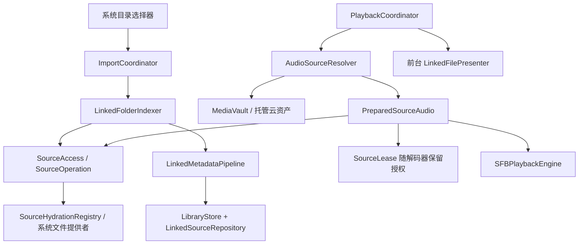

# Link Folder 原位播放：架构与实施说明

适用：iOS 17+、iPadOS 17+、macOS 14+。实现日期：2026-10-31。

## 1. 产品行为

|入口|音频所有者|iMusic 保存的内容|播放来源|
|---|---|---|---|
|Import Music / Wi-Fi Transfer|应用|托管音频、元数据、封面|Media 目录；可选 CloudKit 托管资产|
|Link Folder：本地目录|用户／文件提供者|歌曲记录、本机书签、派生封面|授权目录中的原文件|
|Link Folder：iCloud Drive|iCloud Drive|歌曲记录、本机书签、派生封面|系统物化到文件提供者管理位置的原文件|

关联云端歌曲时，允许系统下载完整音频，以便读取时长、标签和封面。下载完成并验证音频有效后，才发布正式歌曲记录。不把关联音频写入 Media、Staging，也不为关联入库计算整曲哈希。数据库和派生封面仍保存在应用数据区。

系统之后可能回收云端文件的本地内容。每次打开原文件都经过系统协调，不能把“已经入库”当作“永久离线可用”。

## 2. 模块和职责



|源码|职责|
|---|---|
|Domain/LinkedAudioReference.swift|可移植来源描述、本机绑定及恢复任务状态|
|Sources/LinkedFolderIndexer.swift|目录授权、完整遍历、增量入库、重连、逐曲定位|
|Sources/LinkedMetadataPipeline.swift|直接解析源音频、限制封面大小、保留用户修改|
|Sources/SourceAccess.swift|平台书签适配、安全作用域、后台协调、取消与等待上限|
|Sources/SourceHydrationRegistry.swift|合并重叠的系统下载请求；每个读者独立协调与取消|
|Sources/AudioSourceResolver.swift|按来源分派，禁止外部引用回退到托管音频|
|Sources/PreparedSourceAudio.swift|在后台协调期间打开并定位解码器，转交播放后持有授权|
|Sources/LinkedFilePresenter.swift|当前源文件的前台变更、移动、删除、写入让渡及系统驱逐处理|
|Library/LinkedSourceRepository.swift|仅本机的文件绑定和可恢复任务持久化|
|View/Settings / ViewModel/Settings|关联列表、失败任务、重新授权、逐曲定位|
|View/Settings/RelinkSourceView.swift|明确展示重新关联所使用的相对路径，确认后再应用|
|Sync/LegacyMetadataImporter.swift|一次性读取旧版云元数据，避免向旧客户端发送新来源记录|

复制导入仍使用原来的 ImportCoordinator.importFiles 管线。Managed 的同步本地播放入口保留兼容性；Linked 的协调、下载等待、解码器打开和初始定位均在后台完成。View 不访问文件提供者，不持有解码器，也不解析书签。

## 3. 持久化与现有资料库

保持现有唯一的 `initial-schema`，没有新增历史 Schema 迁移，也不修改已安装资料库的建表结构。现有 SQLite 的 records/settings 已能承载新的逻辑模型：

|数据|位置|可同步／备份|
|---|---|---|
|歌曲与用户编辑|records JSON payload|是|
|Managed 的 assetHash|records payload / hash 索引|是|
|LinkedAudioReference：folderID、folderName、relativePath|歌曲 payload|是，仅作为逻辑身份和人工重连提示|
|FolderSource：根书签、授权版本、扫描状态|settings 的 folders|否|
|LinkedFileBinding：稳定 UUID、文件书签、源版本、任务状态与失败次数|settings 的 linked.item.{folderID}.{trackID}|否|
|派生封面|Artwork|是|

来源约束：Managed 必须有合法内容哈希且没有 linkedSource；Linked 必须有合法 linkedSource 且 assetHash 为 nil。旧记录没有 linkedSource，仍是 Managed。Linked 的 records.hash 为 NULL，不参与复制导入的哈希去重，也不参与托管副本合并。

Track.id 独立于文件名、路径和哈希。资料库保存相对定位提示；本机书签保存实际定位与授权。绝对 URL、书签、任务状态、下载缓存状态、授权版本不进入可移植记录。

已有音乐和托管副本全部保留。旧版 FolderSource 未带 usesOriginalFiles 标记时停止自动复制扫描，设置页说明其旧行为；用户重新选择目录后才建立原文件索引。不会自动推断旧副本的所有权、转换所有歌曲或删除旧 Media 文件。

## 4. 目录索引和元数据入库

1. 系统目录选择器取得只读书签。macOS 使用带安全作用域的只读书签；iOS/iPadOS 使用最小书签，并在实际访问时配平安全作用域。
2. 在后台协调目录读取，递归枚举支持的音频格式，跳过隐藏文件、包内部内容及符号链接。枚举或资源属性读取失败时保留旧索引，不将部分结果作为删除依据。
3. 优先解析已有文件书签来匹配身份，路径只是当前定位结果。创建日期用于拒绝旧路径上的替换文件；不把不可跨重启保证稳定的 fileResourceIdentifier 当作持久主键。
4. 新候选预留随机 Track UUID，保存本机准备任务；已入库且源版本未变时跳过音频解析。
5. 对系统确认的 ubiquitous item 请求下载；协调读取等待系统交付可读内容。第三方文件提供者也通过 NSFileCoordinator 提供内容。API 请求返回不等于完成，只有协调读和有效音频解析成功才计为成功入库。
6. 直接解析原文件的时长、采样率、声道、标签和最多 20 MB 的内嵌封面。封面按图片内容寻址；不复制或哈希原音频。
7. 有效音频允许缺少可选标签、艺术家及封面，使用现有占位样式；非法音频保留失败任务，不生成“0 秒已入库歌曲”。
8. 一个事务提交 Track 与本机绑定，重新检查根授权版本及删除标记，阻止旧扫描在取消关联、重新关联或歌曲删除后覆盖当前状态。

索引器串行处理元数据，播放有独立的高优先级工作通道，不会排在整份目录扫描之后。系统下载调度由系统控制；重叠读者合并显式下载请求，每个消费者独立保有可取消的协调请求。不会为后台扫描注册每首歌的长期 presenter。

本机任务记录 pending/preparing/ready/missing/failed/cancelled。失败次数持久化；前台自动扫描每首失败项目最多尝试三次，手动“扫描关联文件夹”可重置预算。不会在网络错误时创建定时无限重试。每次协调等待设置 120 秒预算；取消或超时请求中断 coordinator，并拒绝迟到结果，不承诺系统底层下载也立即停止。

完成、失败或取消的已提交歌曲保留。重启后重新核对目录与源版本，未完成任务可恢复，成功项目不会重复建档。后台切换取消扫描，回到前台补扫（30 秒节流），也可手动扫描。不能承诺 iOS 后台持续目录发现或任意后台下载。

## 5. 播放与资源生命周期

- 当前曲目与下一首都通过来源分派。Linked 永远不会触发 CloudKit 托管音频补齐，也不会尝试构造 Media 路径。
- 根授权、文件书签和授权版本在后台解析。允许 startAccess 返回 false 但已有其他合法访问路径的情况，最终以实际协调和打开结果判断；只配平成功取得的作用域。
- 在协调读中等待内容、验证文件身份和源修改时间、打开解码器并完成初始 seek／A-B 区域准备。源已改变但资料库技术元数据尚未更新时提示先扫描，避免使用错误的时长和采样率定位。
- 访问租约通过解码器关联持有，保留到后台真正释放解码器，不依赖某个 View 的生命周期或一个固定延时。
- 每次选曲和预加载有独立 token。快速切歌、暂停、改队列、改循环、移除歌曲、取消授权都会使旧准备结果失效；迟到回调不能重新开始播放。
- 前台只观察当前原文件。发生写入让渡、变更、移动、删除或系统驱逐时停止当前播放并提示重新打开／修复。进入后台注销 presenter，保留已有播放所需的资源；回前台恢复观察并补扫。
- 系统或外部工具未协调的修改可能先表现为解码错误，正常进入既有错误处理。零复制不等于不可变快照，不承诺边修改源音频边无缝播放。

## 6. 移动、删除和重新关联

|情况|处理|
|---|---|
|同目录／同卷改名，或父目录移动|优先通过书签追踪，保留 Track UUID、收藏、歌单及统计|
|文件移动到枚举根之外但书签仍有效|继续使用已授权的文件引用，不仅凭目录中未见到就删除索引|
|跨提供者或跨卷移动无法恢复|显示不可用，保留歌曲记录，要求明确重新授权／定位|
|旧路径被另一个文件复用|拒绝把替换文件当作原歌曲；新文件单独索引|
|目录无权限／卷离线／扫描失败|记录错误并保留原索引，不同步为其他设备上的歌曲删除|
|源文件删除|标记本机不可用，不自动删除歌曲元数据|
|用户把 Linked 歌曲移入 Trash|仅改变资料库状态，不移动原文件|
|从 Trash 永久删除 Linked 歌曲|保存删除墓碑并清理派生资源，不删除原音频；后续扫描不复活同一文件引用|
|解除目录关联|移除本机根授权配置，停止对应队列引用，保留歌曲元数据与原文件|

设置 → Linked Folders 展示目录、歌曲数、最近扫描、授权错误及失败／缺失任务。重新关联目录先显示预期相对路径，用户确认“同一个音乐目录”后才用这些提示重新绑定，避免静默按同名文件猜测。没有匹配文件的旧歌曲保留 missing 任务。

目录已授权但某首歌无法自动找回时，可对相应任务选择 Locate File，明确指定原文件。解析成功后保持旧 UUID 和用户覆盖的标签、封面、歌单引用与收藏。逐曲定位是本机映射；跨设备仍需各自取得授权。目录整体失效时先重新关联目录。

## 7. 同步和备份

- 元数据使用独立的 iMusicMetadataV2 区域，以及独立的账户同步状态缓存。启动升级后的同步前，一次性用 zone-change fetch 读取旧 iMusicMetadata 中的记录，按稳定 ID 合并；错误不标记完成，可重试。
- 不向旧元数据区域写入新的 Linked 格式；参与新来源同步的设备应升级。旧版 Managed 的 iMusicAssets 内容哈希资产继续复用，不要求重传。
- Linked 只同步歌曲元数据、可移植目录描述和封面，不上传源音频。本机缺少授权不会变成跨设备删除。
- 备份格式为 2，继续读取格式 1。完整备份包含托管音频；Linked 仅包含记录和封面，清单及导出界面明确给出托管歌曲／关联引用数量。
- 书签和本机绑定不进备份。恢复后可展示完整歌曲信息，并要求重新关联；不能把另一台设备的授权当作有效授权。
- 原位播放不提供“自动把外部音频加入完整备份”的暗中复制。需要音频档案时应另行保管原始音乐目录。

## 8. 验证与边界

自动测试使用独立临时资料库及静音 WAV，不启动音频输出。覆盖：无 Media/Staging 音频副本、有效时长、文件／根目录改名、重启、重复扫描、同路径替换防误播、删除和墓碑、部分失败、有限重试、取消迟到结果、暂停与快速切歌、授权撤销、授权代次、显式逐曲重连、用户标签／封面覆盖保留、备份与新设备重连、前后台 presenter、协调删除、连播到托管歌曲后的观察释放及迟到事件隔离。

真实 M4A 回归可设置：

```sh
IMUSIC_SKIP_AUDIO_TESTS=1 \
IMUSIC_LINKED_FIXTURE='/absolute/path/to/song.m4a' \
swift test
```

此测试直接读取源歌曲的时长和封面，检查内容未改变且 Media/Staging 为空，不播放声音。默认不提供外部文件时该项跳过；音频硬件测试仍须显式 opt-in。

真实 iCloud 目录验收使用显式 opt-in，指定目录后允许系统下载其中的音乐：

```sh
mkdir -p .build-linked-validation/icloud
IMUSIC_SKIP_AUDIO_TESTS=1 \
IMUSIC_ICLOUD_FOLDER='/absolute/path/to/iCloud/music-folder' \
IMUSIC_ICLOUD_REPORT_DIRECTORY="$PWD/.build-linked-validation/icloud" \
swift test --filter ICloudFolderAcceptanceTests
```

测试使用该目录作为只读来源，在报告目录新建隔离资料库，通过实际关联扫描链路入库；重新打开 SQLite 后解析书签并逐曲解码 PCM，检查时长、采样率、原路径、Media/Staging 无副本和二次扫描的 UUID 稳定性。不会启动声音输出，也不会驱逐、改名或删除源文件。`acceptance.json` 保存逐曲结果及隔离资料库路径。运行前应另行记录系统下载状态；若原文件已经下载，不能用该次成功入库证明云端到本地的状态转换。

本次验证：107 项测试，102 项通过、5 项音频硬件测试按静音配置跳过；其中 22 项覆盖关联来源，也包含上述真实 M4A 回归。Swift 格式、100 列限制和三语言本地化检查通过。

macOS 构建和 iOS Simulator 构建成功；在 macOS 原生界面完成测试目录入库及重连确认，在 iPhone 15 Pro / iOS 17.4 与 iPad Pro / iPadOS 26.3 模拟器检查了跨设备缺少授权的展示与恢复入口。既有用户资料库未清空；界面验收使用隔离资料库。

2026-10-31 在 macOS 上对用户指定的 iCloud Drive / Musics 实际目录完成验收：目录包含 59 个文件、5 个子目录，约 3.59 GB；其中 57 首为受支持音频（37 FLAC、11 MP3、7 M4A、2 WAV），其余为 `.DS_Store` 和尚未支持的 M4R。57 首全部入库，逐曲从原路径解码 4096 帧，时长与采样率有效；37 首有艺人标签，20 首有派生封面。重复扫描 UUID 不变，Media/Staging 为空，检查前后目录清单、大小、分配空间及系统下载状态一致。

macOS 原生界面通过文件选择器重新授权该目录后扫描成功，All Songs 展示 57 首、总时长 3:21:55，并正确展示已解析的封面；退出并重新启动同一应用后，目录书签仍可扫描，无错误。验收使用隔离资料库，不替换用户既有资料库。测试进程的安全作用域书签不能直接当作应用自己的授权，应用内验收使用自身选择器重新取得授权。

本次读取前 59 个文件的系统状态均为 `NSURLUbiquitousItemDownloadingStatusCurrent`，因此证明的是已物化 iCloud 原文件的实际访问链路，不能声称观察到了“仅云端 → 本地”的转换；没有为测试驱逐用户缓存。对应逐曲报告及前后状态保存在被 Git 忽略的 `.build-linked-validation/icloud/` 下。

构建覆盖 macOS 与支持 iPhone/iPad 的 iOS Simulator 应用。仅云端文件实际下载、离线恢复、提供者驱逐、iPhone/iPad 真机授权及第三方 File Provider 行为仍需逐项验收；本地文件测试或模拟器启动不能替代这些验收。

Foundation 只能枚举文件提供者已经交付的目录信息，不会读取私有 `.icloud` 占位名称或扫描整个 iCloud Drive 猜路径。尚未交付的目录项须等待 Files/Finder 提供后重新扫描；任何临时缺失都不会触发资料库或原文件的自动删除。外部文件的锁屏数据保护及系统缓存回收仍由所有者和系统决定。

公开 API 参考：[安全作用域 URL](https://developer.apple.com/documentation/foundation/url/startaccessingsecurityscopedresource())、[系统物化请求](https://developer.apple.com/documentation/foundation/filemanager/startdownloadingubiquitousitem(at:))、[文件协调与生命周期](https://developer.apple.com/documentation/foundation/nsfilecoordinator)、[文件观察](https://developer.apple.com/documentation/foundation/nsfilepresenter)。
